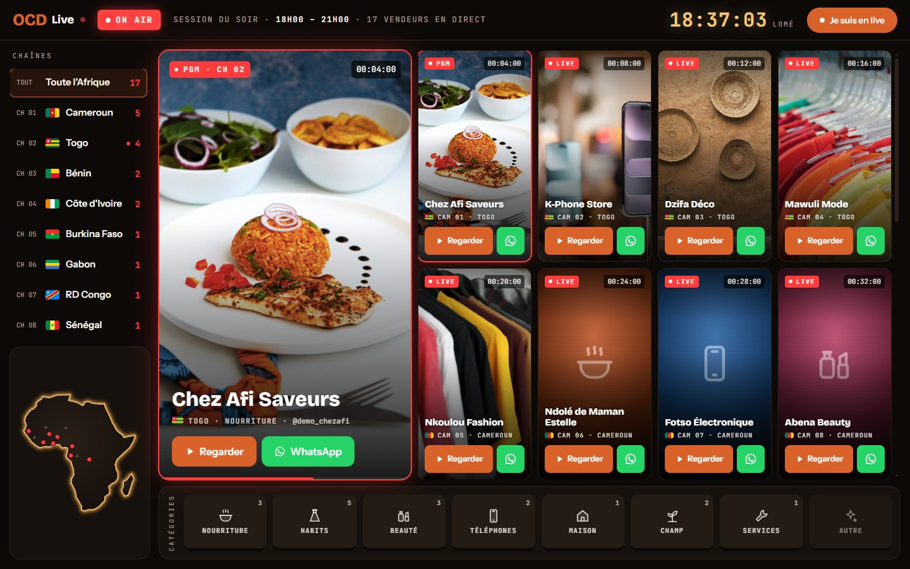
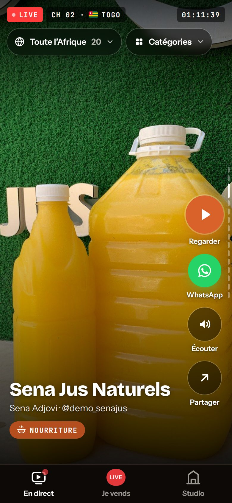
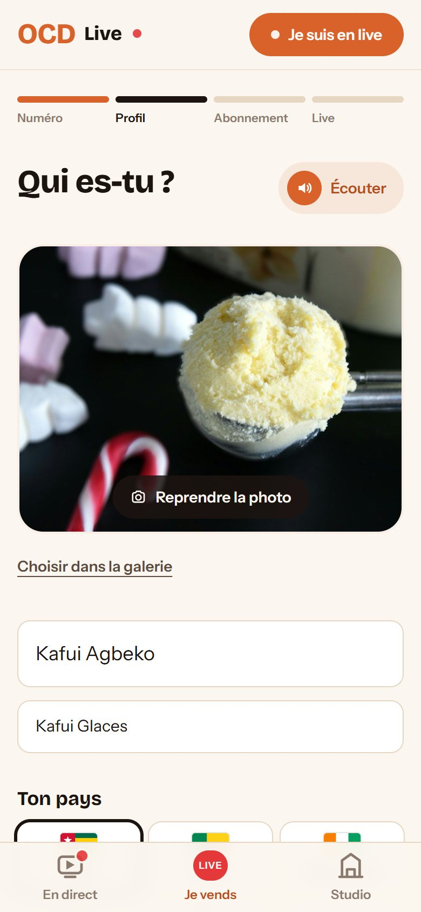
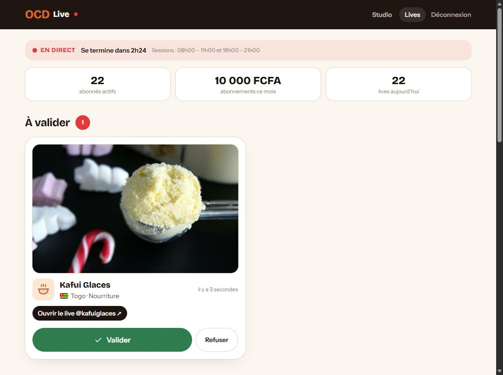

# OCD Live

L'annuaire des vendeurs africains qui vendent en live sur TikTok, et le studio de Lomé où l'on vient faire son live.

- **Le public** voit qui vend en ce moment, par pays et par catégorie, et ouvre le live ou écrit au vendeur sur WhatsApp en un geste.
- **Les vendeurs** s'abonnent, ajoutent la photo de leur produit et appuient sur « Je suis en live ». L'équipe vérifie, puis tout le monde les voit.
- **Le studio de Lomé** se réserve en ligne : créneau de 1h30, au studio ou à distance, paiement Mobile Money.

Le site a l'allure d'une régie de télévision, puisque le concept d'OCD Live est un studio avec sa régie. Il est pensé pour des personnes peu à l'aise avec Internet : peu de texte, de gros boutons, et un bouton « Écouter » qui lit l'écran à voix haute.

> **Version démo** : les vendeurs sont fictifs et les paiements simulés, aucun argent n'est débité.



<table>
  <tr>
    <td width="33%"></td>
    <td width="33%"></td>
    <td width="33%"></td>
  </tr>
  <tr>
    <td align="center">Le fil sur téléphone</td>
    <td align="center">L'espace vendeur</td>
    <td align="center">La validation par l'équipe</td>
  </tr>
</table>

<table>
  <tr>
    <td width="33%"></td>
    <td width="33%"></td>
    <td width="33%"></td>
  </tr>
  <tr>
    <td align="center">L'accueil</td>
    <td align="center">La réservation du studio</td>
    <td align="center">Le planning du studio</td>
  </tr>
</table>

## Fonctionnalités

### Qui vend en live (`/en-direct`)

- **Sur ordinateur, la régie** :
  - les pays deviennent des chaînes (CH 01 Cameroun, CH 02 Togo…), avec une petite carte de l'Afrique ;
  - le PGM montre le live à l'antenne. Il passe au suivant toutes les 8 secondes et s'arrête au survol, et un clic sur n'importe quel moniteur l'y envoie ;
  - le mur de moniteurs affiche, pour chaque live, la photo du produit et un code temporel qui compte depuis la validation ;
  - en bas, les catégories sont des touches de table de mixage : rouge pour la catégorie choisie, verte au survol.
- **Sur téléphone, un vendeur par écran**, à faire défiler vers le haut comme sur TikTok :
  - à droite, les boutons Regarder, WhatsApp, Écouter (la note vocale du vendeur, sinon la voix du téléphone) et Partager ;
  - en haut, deux boutons, « Toute l'Afrique » et « Catégories », qui ouvrent chacun un choix en grandes tuiles.
- **Les nouveaux lives validés** apparaissent tout seuls (la page se recharge toutes les 20 secondes), avec un éclat rouge.
- **Sans photo**, un vendeur s'affiche avec un « signal caméra » dans la couleur de sa catégorie.

### Espace vendeur (`/vendre`)

1. Numéro WhatsApp et code à 4 chiffres, sans mot de passe.
2. Profil :
   - une photo du produit, prise directement avec l'appareil photo ou choisie dans la galerie. Elle est réduite dans le téléphone avant l'envoi (1080 px, environ 100 Ko) ;
   - le nom, le pays, la catégorie et le nom TikTok ;
   - une note vocale, facultative.
3. Abonnement de 5 000 FCFA par mois, payé par Mobile Money.
4. Le gros bouton rouge « Je suis en live ». L'écran suit la validation de l'équipe en direct.

### Espace équipe (`/admin`)

- **Lives à valider** (`/admin/lives`) : la photo envoyée par le vendeur, « Ouvrir le live », « Écouter sa voix », « Valider » ou « Refuser » (motif en un clic), et la liste des lives à l'antenne avec un bouton « Terminer ».
- **Studio** (`/admin`) : planning jour par jour, notifications, chiffre encaissé, taux de remplissage et prochains lives.

### Sessions

Les lives sont validés pendant deux sessions par jour, de 8h à 11h et de 18h à 21h (heure de Lomé). Un live validé disparaît tout seul à la fin de sa session.

### Studio de Lomé (`/reserver`)

- **Réservation en 6 étapes** : format (au studio ou à distance), jour (calendrier avec les disponibilités en temps réel), créneau de 1h30, forfait (6 packs), infos du business, paiement Mobile Money.
- **Un créneau, une seule réservation** : le studio n'a qu'une régie. Une contrainte d'unicité en base empêche deux personnes de prendre le même créneau, même si elles paient au même moment.
- **Notifications** : l'équipe reçoit un e-mail et une notification dans l'espace équipe. Le client reçoit une confirmation s'il a laissé son e-mail.

### Animations

- Les moniteurs de la régie s'allument un par un (écran noir, éclair blanc, puis l'image).
- Le PGM passe d'un live à l'autre en fondu, et les voyants ON AIR et LIVE respirent doucement.
- Le parcours de réservation et le billet de confirmation sont animés.
- Le réglage « réduire les animations » de l'appareil est respecté : pas d'éclair, et le PGM ne change pas tout seul.

## Technologies

Laravel 12 (PHP 8.2+) · Vue 3 + Inertia 2 · Tailwind CSS 4 · Vite 7 · GSAP · SQLite

## Lancer le projet

### Sous Windows, en un double-clic

Prérequis : PHP 8.2 ou plus récent, [Composer](https://getcomposer.org) et [Node.js](https://nodejs.org) 20.19 ou plus récent.

```bat
git clone https://github.com/Luc-Arthur/ocd-live-.git
cd ocd-live-
demarrer.bat
```

Au premier lancement, `demarrer.bat` :

1. installe les dépendances PHP et front ;
2. crée le fichier `.env`, la clé de l'application et la base SQLite ;
3. crée les tables et les remplit : forfaits, compte équipe, réservations de démo, 20 vendeurs fictifs (17 en live, 3 à valider), dont 7 avec une vraie photo de produit ;
4. compile le front et lance le serveur sur <http://localhost:8000> ;
5. ouvre un tunnel Cloudflare et affiche un lien public `https://….trycloudflare.com`, si `cloudflared` est installé (voir [Partager la démo](#partager-la-démo)).

Aux lancements suivants, il saute les installations déjà faites.

### À la main (macOS, Linux ou Windows)

```bash
composer install
cp .env.example .env
php artisan key:generate
touch database/database.sqlite
php artisan migrate --seed
npm install
npm run build
php artisan serve
```

Le site est alors sur <http://localhost:8000>.

### Développer

- **macOS / Linux** : `composer run dev` lance en parallèle le serveur, la file d'attente, les logs et Vite avec rechargement à chaud.
- **Windows** : `composer run dev` ne fonctionne pas, car Laravel Pail a besoin de l'extension PHP `pcntl`, indisponible sous Windows. Lance plutôt `php artisan serve` et `npm run dev` dans deux terminaux.

### Tests

```bash
php artisan test
```

Les tests de la photo du vendeur demandent l'extension PHP GD (incluse dans XAMPP).

## Accès démo

**Espace équipe** : <http://localhost:8000/admin>

- E-mail : `admin@ocdlive.test`
- Mot de passe : `ocdlive2026`

Ce compte est créé par le seeder. Sur la page de connexion, un bouton « Accès démo » peut afficher et remplir ces identifiants. Il est masqué par défaut : mets `OCD_SHOW_DEMO_LOGIN=true` dans le `.env` pour l'afficher.

**Espace vendeur** : <http://localhost:8000/vendre>. N'importe quel numéro fonctionne. Le code, `1234` par défaut, est affiché à l'écran.

## Réglages

Les réglages propres à OCD Live se font dans le `.env` :

| Variable | Rôle | Valeur par défaut |
| --- | --- | --- |
| `OCD_LAUNCH_DATE` | Premier jour de lives au studio | `2026-12-01` |
| `OCD_BOOKING_WINDOW_DAYS` | Nombre de jours ouverts à la réservation du studio | `90` |
| `OCD_TEAM_EMAIL` | Adresse qui reçoit les réservations | `reservations@ocdlive.test` |
| `OCD_WHATSAPP` | Numéro WhatsApp de l'équipe, au format international sans `+` (affiche le bouton WhatsApp sur la confirmation) | vide |
| `OCD_TIKTOK_ACCOUNT` | Compte TikTok sur lequel les lives du studio sont diffusés | `@bovann` |
| `OCD_STUDIO_ADDRESS` | Adresse du studio, affichée en pied de page | `Studio OCD Live, Lomé` |
| `OCD_SHOW_DEMO_LOGIN` | Affiche le bouton « Accès démo » sur la page de connexion | `false` |
| `OCD_SESSIONS_ALWAYS_OPEN` | Démo : session ouverte en continu, pour montrer le site à toute heure. En production : `false` (sessions de 8h à 11h et de 18h à 21h) | `true` |
| `OCD_DEMO_CODE` | Démo : code de connexion vendeur, affiché à l'écran | `1234` |

Autres réglages :

- **E-mails** : avec `MAIL_MAILER=log` (par défaut), ils ne partent pas : ils sont écrits dans `storage/logs/laravel.log`. Renseigne un serveur SMTP dans le `.env` pour les envoyer vraiment.
- **Pays, catégories, horaires des sessions, prix de l'abonnement, créneaux du studio et moyens de paiement** : [`config/ocdlive.php`](config/ocdlive.php).
- **Prix et contenu des forfaits du studio** : [`database/seeders/DatabaseSeeder.php`](database/seeders/DatabaseSeeder.php).

## Partager la démo

Pour donner un lien public vers ton PC le temps d'une démo, installe `cloudflared` :

```bat
winget install --id Cloudflare.cloudflared
```

`demarrer.bat` ouvre alors le tunnel tout seul. Tu peux aussi le lancer à la main, serveur démarré :

```bash
cloudflared tunnel --url http://localhost:8000
```

Le lien change à chaque lancement et ne marche que tant que ton PC et la fenêtre restent allumés.

**À savoir avant de partager le lien** :

- Les identifiants de démo sont publics, puisqu'ils figurent dans ce README. Change le mot de passe du compte équipe si le lien doit circuler largement.
- Les réservations, les inscriptions de vendeurs et les photos envoyées via le lien sont enregistrées sur ton PC.
- Tant que `APP_DEBUG=true`, une erreur affiche des détails techniques aux visiteurs.

## Où trouver quoi

| Fichier | Contenu |
| --- | --- |
| [`app/Http/Controllers/DirectoryController.php`](app/Http/Controllers/DirectoryController.php) | `/en-direct` : lives à l'antenne, filtres pays et catégorie, chaînes |
| [`app/Http/Controllers/SellerController.php`](app/Http/Controllers/SellerController.php) | Espace vendeur : connexion, profil et photo, abonnement, « Je suis en live » |
| [`app/Http/Controllers/Admin/`](app/Http/Controllers/Admin/) | Connexion, planning du studio et validation des lives |
| [`app/Services/LiveSessionService.php`](app/Services/LiveSessionService.php) | Sessions de 8h-11h et 18h-21h |
| [`app/Http/Controllers/BookingController.php`](app/Http/Controllers/BookingController.php) | Réservation du studio et paiement simulé (`store`) |
| [`app/Services/SlotService.php`](app/Services/SlotService.php) | Fenêtre de réservation et créneaux libres du studio |
| [`resources/js/Components/Regie/`](resources/js/Components/Regie/) | La régie (ordinateur), le fil vertical (téléphone), les moniteurs, la table de mixage |
| [`resources/js/regie.js`](resources/js/regie.js) | Horloge de Lomé, codes temporels, « Écouter », allumage des moniteurs |
| [`resources/js/photo.js`](resources/js/photo.js) | Réduction de la photo dans le téléphone avant l'envoi |
| [`resources/js/Pages/`](resources/js/Pages/) | Pages Vue : accueil, en direct, espace vendeur, réservation, espace équipe |
| [`resources/js/motion.js`](resources/js/motion.js) | Outils d'animation (GSAP) |
| [`database/seeders/`](database/seeders/) | Forfaits, compte équipe, réservations et vendeurs de démo, [photos de démo](database/seeders/photos/CREDITS.md) |

Les photos des vendeurs de démo sont libres de droits ([licence Unsplash](https://unsplash.com/license)). Leurs auteurs sont cités dans [`database/seeders/photos/CREDITS.md`](database/seeders/photos/CREDITS.md).

## Avant la mise en production

- **Paiements** : brancher un agrégateur qui couvre le Togo et le Mobile Money (T-Money, Flooz, MTN, Orange, Wave, carte), par exemple CinetPay, PayDunya ou Moneroo, avec confirmation par webhook. C'est à faire pour l'abonnement des vendeurs (`SellerController@subscribe`) comme pour la réservation du studio (`BookingController@store`).
- **Connexion des vendeurs** : envoyer le code par WhatsApp (API WhatsApp Business) ou par SMS au lieu de l'afficher à l'écran.
- **Sessions** : passer `OCD_SESSIONS_ALWAYS_OPEN=false`.
- **Compte équipe** : changer le mot de passe (celui de démo est public) et laisser `OCD_SHOW_DEMO_LOGIN` à `false`.
- **Configuration** : passer `APP_ENV=production` et `APP_DEBUG=false`.
- **Notifications** : prévenir aussi l'équipe par WhatsApp ou SMS, en plus de l'e-mail.
- **Packs du studio** : planifier les lives suivants d'un pack directement depuis l'espace équipe.
