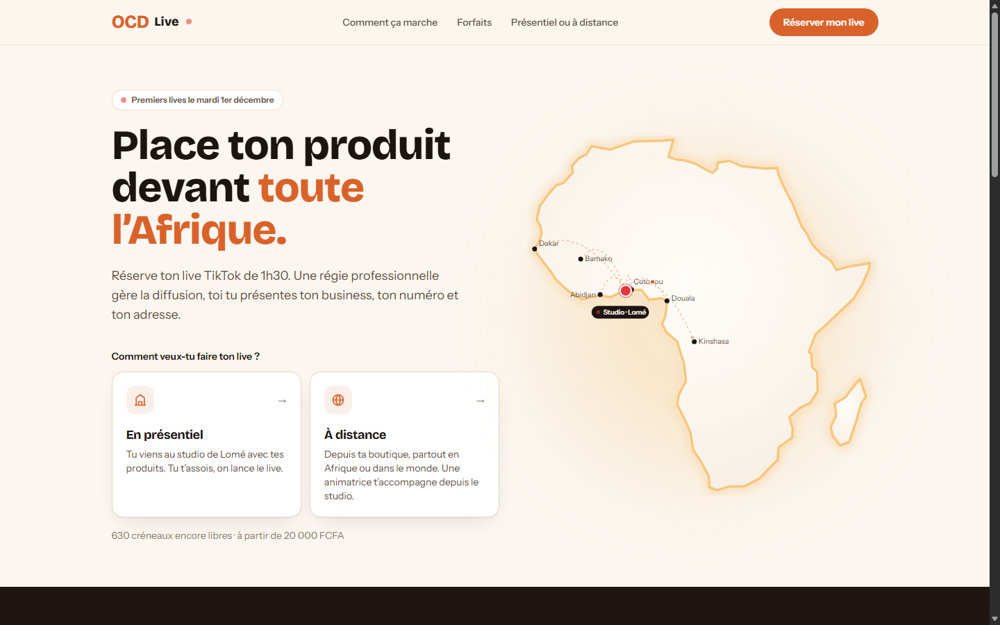
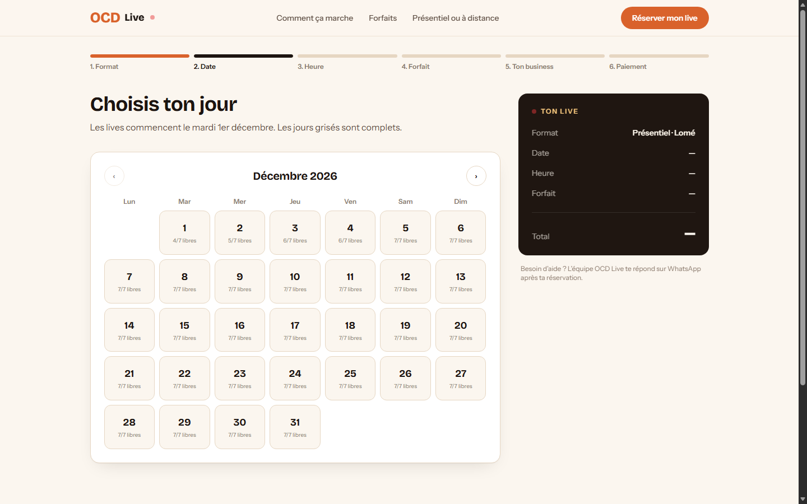
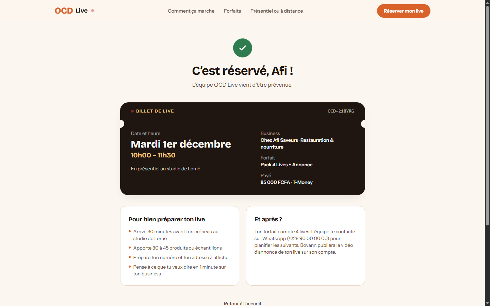
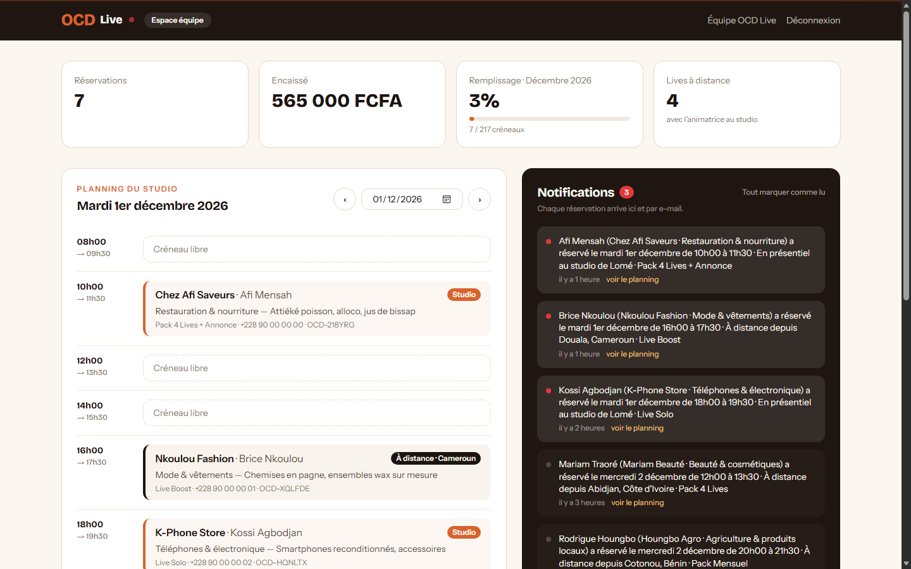

# OCD Live

Site de réservation de lives TikTok pour le studio OCD Live, à Lomé. Un vendeur choisit son format (au studio ou à distance), son jour, son créneau de 1h30 et son forfait, puis paie par Mobile Money. L'équipe est prévenue aussitôt.

> **Version démo** : le paiement est simulé, aucun argent n'est débité.



<table>
  <tr>
    <td></td>
    <td></td>
    <td></td>
  </tr>
  <tr>
    <td align="center">Réservation</td>
    <td align="center">Confirmation</td>
    <td align="center">Espace équipe</td>
  </tr>
</table>

## Fonctionnalités

- **Accueil** : les deux formats de live sont visibles dès l'ouverture : en présentiel au studio de Lomé, ou à distance depuis n'importe quel pays.
- **Réservation en 6 étapes** : format, jour (calendrier avec les disponibilités en temps réel), créneau de 1h30, forfait (6 packs), infos du business, paiement Mobile Money.
- **Un créneau, une seule réservation** : le studio n'a qu'une régie. Une contrainte d'unicité en base empêche deux personnes de prendre le même créneau, même si elles paient au même moment.
- **Notifications** : à chaque réservation, l'équipe reçoit un e-mail et une notification dans l'espace équipe, par exemple « Afi Mensah (Chez Afi Saveurs) a réservé le mardi 1er décembre de 10h00 à 11h30 · En présentiel au studio de Lomé ». Le client reçoit une confirmation s'il a laissé son e-mail.
- **Espace équipe** (`/admin`) : planning du studio jour par jour, notifications, chiffre encaissé, taux de remplissage et prochains lives. La page se met à jour toute seule toutes les 20 secondes.
- **Animations** : sur l'accueil, la carte de l'Afrique montre le studio de Lomé relié aux vendeurs à distance. Le parcours de réservation et le billet de confirmation sont animés, et les nouvelles réservations apparaissent en douceur dans l'espace équipe. Le réglage « réduire les animations » de l'appareil est respecté.

## Technologies

Laravel 12 (PHP 8.2+) · Vue 3 + Inertia 2 · Tailwind CSS 4 · Vite 7 · GSAP · SQLite

## Lancer le projet

### Sous Windows, en un double-clic

Prérequis : PHP 8.2 ou plus récent, [Composer](https://getcomposer.org) et [Node.js](https://nodejs.org) 20.19 ou plus récent.

```bat
git clone https://github.com/Luc-Arthur/ocd-live-.git
cd ocd-live-
demarrer.bat
```

Au premier lancement, `demarrer.bat` :

1. installe les dépendances PHP et front ;
2. crée le fichier `.env`, la clé de l'application et la base SQLite ;
3. crée les tables et les remplit (forfaits, compte équipe, réservations de démo) ;
4. compile le front et lance le serveur sur <http://localhost:8000> ;
5. ouvre un tunnel Cloudflare et affiche un lien public `https://….trycloudflare.com`, si `cloudflared` est installé (voir [Partager la démo](#partager-la-démo)).

Aux lancements suivants, il saute les installations déjà faites.

### À la main (macOS, Linux ou Windows)

```bash
composer install
cp .env.example .env
php artisan key:generate
touch database/database.sqlite
php artisan migrate --seed
npm install
npm run build
php artisan serve
```

Le site est alors sur <http://localhost:8000>.

### Développer

- **macOS / Linux** : `composer run dev` lance en parallèle le serveur, la file d'attente, les logs et Vite avec rechargement à chaud.
- **Windows** : `composer run dev` ne fonctionne pas, car Laravel Pail a besoin de l'extension PHP `pcntl`, indisponible sous Windows. Lance plutôt `php artisan serve` et `npm run dev` dans deux terminaux.

## Accès démo

Espace équipe : <http://localhost:8000/admin>

- E-mail : `admin@ocdlive.test`
- Mot de passe : `ocdlive2026`

Ce compte est créé par le seeder. Sur la page de connexion, un bouton « Accès démo » peut afficher et remplir ces identifiants. Il est masqué par défaut : mets `OCD_SHOW_DEMO_LOGIN=true` dans le `.env` pour l'afficher.

## Réglages

Les réglages propres à OCD Live se font dans le `.env` :

| Variable | Rôle | Valeur par défaut |
| --- | --- | --- |
| `OCD_LAUNCH_DATE` | Premier jour de lives | `2026-12-01` |
| `OCD_BOOKING_WINDOW_DAYS` | Nombre de jours ouverts à la réservation | `90` |
| `OCD_TEAM_EMAIL` | Adresse qui reçoit les réservations | `reservations@ocdlive.test` |
| `OCD_WHATSAPP` | Numéro WhatsApp de l'équipe, au format international sans `+` (affiche le bouton WhatsApp sur la confirmation) | vide |
| `OCD_TIKTOK_ACCOUNT` | Compte TikTok sur lequel les lives sont diffusés | `@bovann` |
| `OCD_STUDIO_ADDRESS` | Adresse du studio, affichée en pied de page | `Studio OCD Live, Lomé` |
| `OCD_SHOW_DEMO_LOGIN` | Affiche le bouton « Accès démo » sur la page de connexion | `false` |

Autres réglages :

- **E-mails** : avec `MAIL_MAILER=log` (par défaut), ils ne partent pas : ils sont écrits dans `storage/logs/laravel.log`. Renseigne un serveur SMTP dans le `.env` pour les envoyer vraiment.
- **Prix et contenu des forfaits** : [`database/seeders/DatabaseSeeder.php`](database/seeders/DatabaseSeeder.php).
- **Créneaux horaires, types d'activité et moyens de paiement** : [`config/ocdlive.php`](config/ocdlive.php).

## Partager la démo

Pour donner un lien public vers ton PC le temps d'une démo, installe `cloudflared` :

```bat
winget install --id Cloudflare.cloudflared
```

`demarrer.bat` ouvre alors le tunnel tout seul. Tu peux aussi le lancer à la main, serveur démarré :

```bash
cloudflared tunnel --url http://localhost:8000
```

Le lien change à chaque lancement et ne marche que tant que ton PC et la fenêtre restent allumés.

**À savoir avant de partager le lien** : les identifiants de démo sont publics, puisqu'ils figurent dans ce README. Change le mot de passe du compte équipe si le lien doit circuler largement. Les réservations faites via le lien sont enregistrées dans ta base. Et tant que `APP_DEBUG=true`, une erreur affiche des détails techniques aux visiteurs.

## Où trouver quoi

| Fichier | Contenu |
| --- | --- |
| [`app/Http/Controllers/BookingController.php`](app/Http/Controllers/BookingController.php) | Parcours de réservation et paiement simulé (`store`) |
| [`app/Services/SlotService.php`](app/Services/SlotService.php) | Fenêtre de réservation et créneaux libres |
| [`app/Http/Controllers/Admin/`](app/Http/Controllers/Admin/) | Connexion et tableau de bord de l'équipe |
| [`app/Notifications/`](app/Notifications/) | E-mail et notification pour l'équipe, confirmation pour le client |
| [`config/ocdlive.php`](config/ocdlive.php) | Créneaux, activités, moyens de paiement, réglages |
| [`database/seeders/DatabaseSeeder.php`](database/seeders/DatabaseSeeder.php) | Forfaits, compte équipe, réservations de démo |
| [`resources/js/Pages/`](resources/js/Pages/) | Pages Vue : accueil, réservation, confirmation, espace équipe |
| [`resources/js/motion.js`](resources/js/motion.js) | Outils d'animation (GSAP) |

## Avant la mise en production

- **Paiement** : brancher un agrégateur qui couvre le Togo et le Mobile Money (T-Money, Flooz, MTN, Orange, Wave, carte), avec confirmation par webhook, à la place du paiement simulé dans `BookingController@store`.
- **Compte équipe** : changer le mot de passe (celui de démo est public) et laisser `OCD_SHOW_DEMO_LOGIN` à `false`.
- **Configuration** : passer `APP_ENV=production` et `APP_DEBUG=false`.
- **Notifications** : prévenir aussi l'équipe par WhatsApp ou SMS, en plus de l'e-mail.
- **Packs** : planifier les lives suivants d'un pack directement depuis l'espace équipe.
